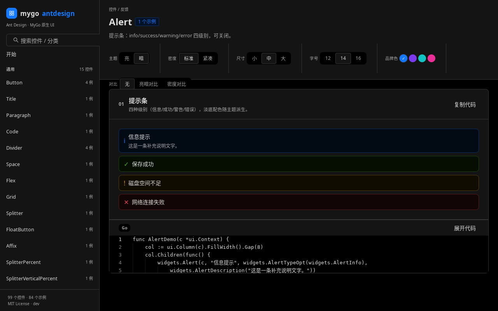

# mygo-antdesign

[](https://github.com/lishuangquan1987/mygo-antdesign/actions/workflows/ci.yml)
[](https://github.com/lishuangquan1987/mygo-antdesign/actions/workflows/release.yml)
[](https://pkg.go.dev/github.com/lishuangquan1987/mygo-antdesign)
[](go.mod)
[](LICENSE)

> Ant Design 设计风格的 [MyGo](https://github.com/egoist/mygo) 原生 UI 控件库：为 `package ui` 提供完整的 antd 视觉、交互与设计 Token，并补齐 antd 有而 MyGo 暂缺的控件。

MyGo 是纯 Go、无 cgo 的桌面 UI 框架（即时模式，`view = f(state)`）。本库在它的 `Theme` / `Base` 之上做「外观与交互」的一层：一套 Token 驱动全部控件，支持**运行时**切换亮/暗、品牌色与**标准/紧凑**双密度；所有控件都带**可运行示例**、**单元测试**与**截图基线**，示例由 Gallery 应用统一展示。


*Gallery：左侧控件目录（分类 + 搜索），中间实时预览，下方是可复制的真实示例代码；顶部切换亮/暗、标准/紧凑与品牌色，并支持同屏对比。*



*暗色主题下的 Gallery（同样的目录、预览与代码区，一键切换）。*

## 目录

- [特性](#特性)
- [本地运行 Gallery](#本地运行-gallery)
- [安装](#安装)
- [快速开始](#快速开始)
- [控件覆盖](#控件覆盖)
- [主题与密度](#主题与密度)
- [开发与测试](#开发与测试)
- [项目结构](#项目结构)
- [文档](#文档)
- [版本与发布](#版本与发布)
- [贡献](#贡献)
- [License](#license)

## 特性

- **Ant Design 视觉规范**：颜色、圆角、间距、字号、焦点环、禁用态全部走 Token，不做零散硬编码。
- **144 个控件构造函数**：`widgets/`（包名 `ant`）137 个换肤/补全控件 + `extra/` 7 个复杂缺口控件。
- **MyGo 全量覆盖**：`package ui` 111 个构造函数逐项审计，同类型控件按 MyGo 命名；覆盖矩阵见 [docs/02 §九](docs/02-widget-mapping.md)。
- **双密度**：标准（antd 默认）与紧凑（`Spacing` 4→3、`Radius` 6→4、`FontSize` 14→13），一套代码运行时切换。
- **运行时换肤**：`theme.Apply` 全局、`theme.Sub` 局部；亮/暗、品牌色、密度可任意组合，弹层/菜单/Tooltip 自动跟随。
- **可选跟随系统**：`theme.WithFollowSystem()` 叠加系统强调色、高对比与文字缩放（默认关闭，保证品牌色忠实）。
- **示例即交付物**：13 个示例分组 / 84 个示例片段，全部是可编译的真实代码；`go:embed` 提取后与 Gallery 预览一一对应。
- **视觉回归**：3 张 Gallery 级 + 324 张逐示例截图基线（亮/暗 × 标准/紧凑），CI 逐字节比对。
- **细节对齐 antd v5**：表格、页签、输入焦点环、进度、卡片、弹窗等按 antd Token 校准（见 [docs/09](docs/09-antd-parity.md)）。
- **纯 Go**：无 cgo，可交叉编译到 Windows / macOS / Linux（amd64、arm64）。

## 本地运行 Gallery

Gallery 是 `gallery/` 下的独立可执行程序，直接展示全部控件与真实代码。

**前置条件**

- Go **1.27.4+**（`go.mod` 中已锁定 MyGo v0.10.0）
- 桌面环境：Windows 10+ / macOS 11+ / Linux（X11 或 Wayland）
- 无需安装 cgo 工具链；首次运行会自动下载 Go 依赖

**方式一：直接运行（开发时最常用）**

```bash
git clone https://github.com/lishuangquan1987/mygo-antdesign.git
cd mygo-antdesign

# 编译并启动 Gallery 窗口
go run ./gallery
```

**方式二：构建二进制**

```bash
# Linux / macOS
go build -trimpath -ldflags "-X main.version=v0.5.0" -o bin/gallery ./gallery
./bin/gallery

# Windows（PowerShell / cmd）
go build -trimpath -ldflags "-X main.version=v0.5.0" -o bin/gallery.exe ./gallery
bin\gallery.exe
```

> 若使用 Make，可执行 `make run`（直接运行）或 `make build`（输出 `bin/gallery`）。

**方式三：下载安装包**

到 [Releases](https://github.com/lishuangquan1987/mygo-antdesign/releases) 下载对应平台的归档（`mygo-ant-design-gallery-<版本>-<系统>-<架构>.zip|tar.gz`），解压后运行其中的 `mygo-ant-design-gallery` 可执行文件。安装包由 [Release 工作流](.github/workflows/release.yml) 在发布时自动构建并上传；也可在 Actions 页面手动触发，填入已发布的 tag（草稿 Release 不可见）后构建并上传到对应 Release。

> Linux 下若无法弹出窗口，请确认已安装 X11/Wayland 运行库；macOS 首次运行如被 Gatekeeper 拦截，可在「系统设置 → 隐私与安全性」中允许，或执行 `xattr -dr com.apple.quarantine mygo-ant-design-gallery`。

## 安装

```bash
go get github.com/lishuangquan1987/mygo-antdesign@v0.5.0
```

## 快速开始

```go
package main

import (
	"fmt"
	"log"

	"github.com/egoist/mygo"
	"github.com/egoist/mygo/ui"

	"github.com/lishuangquan1987/mygo-antdesign/theme"
	widgets "github.com/lishuangquan1987/mygo-antdesign/widgets"
)

func main() {
	name := ""
	remember := false

	mygo.App.WhenReady(func() {
		mygo.NewWindow(mygo.WindowOptions{
			Title: "Hello mygo-antdesign",
			Content: ui.View(func(c *ui.Context) {
				// 一行接入主题：亮色预设 + 自定义品牌色。
				theme.Apply(c, theme.Light(theme.WithPrimary(ui.RGB(0x16, 0x77, 0xff))))

				// 间距一律走主题度量，切换密度时自动缩放。
				t := c.Theme()
				col := ui.Column(c).Gap(t.Space(3)).Padding(t.Space(6))
				col.Children(func() {
					widgets.Title(c, "登录", widgets.H2)
					widgets.Input(c, &name, widgets.PlaceholderText("用户名"))
					widgets.Checkbox(c, &remember, "记住我")
					widgets.Button(c, "登录", widgets.Primary(), widgets.OnClick(func() {
						fmt.Println("登录：", name, remember)
					}))
				})
			}),
		})
	})

	if err := mygo.App.Run(); err != nil {
		log.Fatal(err)
	}
}
```


更多用法：主题自定义见 [docs/04](docs/04-theme-system.md)，紧凑密度见 [docs/05](docs/05-compact-density.md)，从 MyGo 原生控件迁移见 [docs/08](docs/08-migration.md)。

## 控件覆盖

| 分类 | 主要控件 | 示例 |
| --- | --- | --- |
| 通用 | Button、Typography（Title/Paragraph/Code）、Divider、Space/Flex/Grid | [button](samples/button)、[typography](samples/typography)、[divider](samples/divider)、[layout](samples/layout) |
| 数据录入 | Input、TextArea、NumberInput、SearchField、DatePicker、TimePicker、Form、AutoComplete、ColorPicker、Mentions | [input](samples/input) |
| 选择 | Checkbox、Radio、Switch、Slider、Rate、Segmented、Select、Combobox、Toggle | [selectdemo](samples/selectdemo) |
| 数据展示 | Table、Tag、Badge、Avatar、Card、Empty、Result、Skeleton、Statistic、Descriptions、Timeline、List、Image、Meter、Masonry | [display](samples/display)、[table](samples/table) |
| 反馈 | Alert、Modal、Drawer、Message/Notify、Notification、Progress（线形/环形）、Spin、Tooltip、Popconfirm、Popover、Tour、Watermark | [feedback](samples/feedback) |
| 导航 | Breadcrumb、Tabs、Dropdown、Pagination、Steps、Sidebar、Anchor | [nav](samples/nav) |
| 复杂缺口 | Tree、TreeSelect、Cascader、Upload、Transfer、Carousel、QRCode | [extrademo](samples/extrademo) |
| 场景 | 紧凑型 IDE 布局（侧栏/标签页/代码区/状态栏） | [ide](samples/ide) |

完整逐项映射（含实现状态与已知限制）见 [docs/02 控件换肤映射](docs/02-widget-mapping.md) 与 [docs/03 缺口控件](docs/03-gap-widgets.md)。

## 主题与密度

```go
// 全局：亮色 + 品牌色 + 紧凑密度
theme.Apply(c, theme.Light(
	theme.WithPrimary(ui.Hex("#1677ff")),
	theme.WithDensity(theme.Compact),
))

// 局部：同一窗口内并排演示亮/暗
left := theme.Sub(c, theme.Light())
right := theme.Sub(c, theme.Dark())
```

- Token → `ui.Theme` 的完整映射见 [docs/04](docs/04-theme-system.md)。
- 标准/紧凑的数值规范见 [docs/05](docs/05-compact-density.md)。
- 控件内部禁止裸颜色/裸间距，由 `go run ./internal/check` 静态把关。

## 开发与测试

所有命令在仓库根目录执行：

```bash
go run ./gallery          # 启动 Gallery（等价 make run）
go build ./...            # 构建全部包
go test ./...             # 单元测试 + 截图基线
go vet ./...              # 静态检查
go run ./internal/check   # 样式铁律：禁止 widgets/extra 裸颜色、裸间距
```

使用 Make（可选）：

```bash
make run        # 运行 Gallery
make build      # 构建 bin/gallery
make test       # go test -count=1 ./...
make check      # gofmt + vet + test + 样式检查
make baselines  # 重新生成截图基线（Gallery 级 + 逐示例）
```

人工核对控件效果（不使用 computer use，直接渲染 PNG）：

```bash
go run ./scripts/visualcheck -group 反馈 -theme dark -out .visualcheck
# 输出 .visualcheck/*.png，可直接查看
```

新增控件/示例的流程与 DoD 见 [AGENTS.md](AGENTS.md) 与 [docs/06](docs/06-development-plan.md)。

## 项目结构

```
.
├── theme/        # Token 定义、亮/暗预设、AntToken → ui.Theme 桥接
├── widgets/      # 换肤后的控件（包名 ant）
├── extra/        # 复杂缺口控件：Tree / Upload / Transfer / Carousel / QRCode / Cascader / TreeSelect
├── icon/         # 44 个 antd outlined 图标常量 + 渲染函数
├── samples/      # 真实可编译的示例源码（go:embed 提取片段）+ golden 截图基线
├── gallery/      # 示例展示应用（本地运行入口）
├── internal/     # 共享度量、状态映射、样式静态检查
├── scripts/      # genicons（图标生成）、visualcheck（示例渲染核对）、package（发布打包，纯 Go）
└── docs/         # 设计文档、ADR 与截图
```

## 文档

| 文档 | 内容 |
| --- | --- |
| [01 可行性分析](docs/01-feasibility.md) | 技术契合度、架构分层、工作量与风险 |
| [02 控件换肤映射](docs/02-widget-mapping.md) | MyGo v0.10.0 原生控件 → antd 皮肤的逐项映射与状态 |
| [03 缺口控件](docs/03-gap-widgets.md) | antd 有而 MyGo 无的控件：已交付与不移植项 |
| [04 主题系统](docs/04-theme-system.md) | Token 映射、运行时切换、全局/局部主题 |
| [05 紧凑密度](docs/05-compact-density.md) | 标准/紧凑密度规范与数值表 |
| [06 开发计划](docs/06-development-plan.md) | WBS、里程碑、DoD、风险与当前进度 |
| [07 示例与 Gallery](docs/07-samples-gallery.md) | 示例结构、覆盖矩阵、截图回归、如何新增示例 |
| [08 迁移指南](docs/08-migration.md) | 从 MyGo 原生控件迁移的对照表与限制 |
| [09 antd 细节对齐](docs/09-antd-parity.md) | 尺寸/间距/状态/交互的逐项审计与仍存在的差异 |
| [CHANGELOG](CHANGELOG.md) | 版本变更记录 |

## 版本与发布

- 遵循 [语义化版本](https://semver.org/lang/zh-CN/)；当前版本 **v0.5.0**。
- 发布流程：创建 Release → [Release 工作流](.github/workflows/release.yml) 自动为 5 个平台构建 Gallery 安装包并上传到该 Release 附件；也可在 Actions 页面手动触发（`workflow_dispatch`）并填入已存在的 tag。
- **注意**：`release` 事件使用的是 **tag 内的 workflow 文件**。如果某个旧 tag 的工作流版本较老（例如 v0.2.0 之前），它的 Release 构建可能失败；此时请在 Actions 页面手动触发 `Release`（workflow 取 main 上的最新版本），填入该 tag 重新上传，或基于最新 main 打新 tag 发布。
- 历史版本与变更见 [CHANGELOG.md](CHANGELOG.md) 与 [Releases](https://github.com/lishuangquan1987/mygo-antdesign/releases)。

## 贡献

欢迎提交 Issue 与 Pull Request：

1. Fork 并新建分支：`git checkout -b feat/your-feature`。
2. 遵守 [AGENTS.md](AGENTS.md) 中的样式铁律与 API 约定；新增控件必须同时补示例、单元测试与截图基线。
3. 提交前运行 `make check`（gofmt / vet / test / 样式检查）与 `go test ./gallery ./samples -count=1`。
4. 使用中文提交信息，格式 `feat(widgets): ...` / `fix(theme): ...` / `docs: ...`。
5. 提交 PR 并描述动机与验证方式。

## License

[MIT](LICENSE) © 2026 lishuangquan1987
