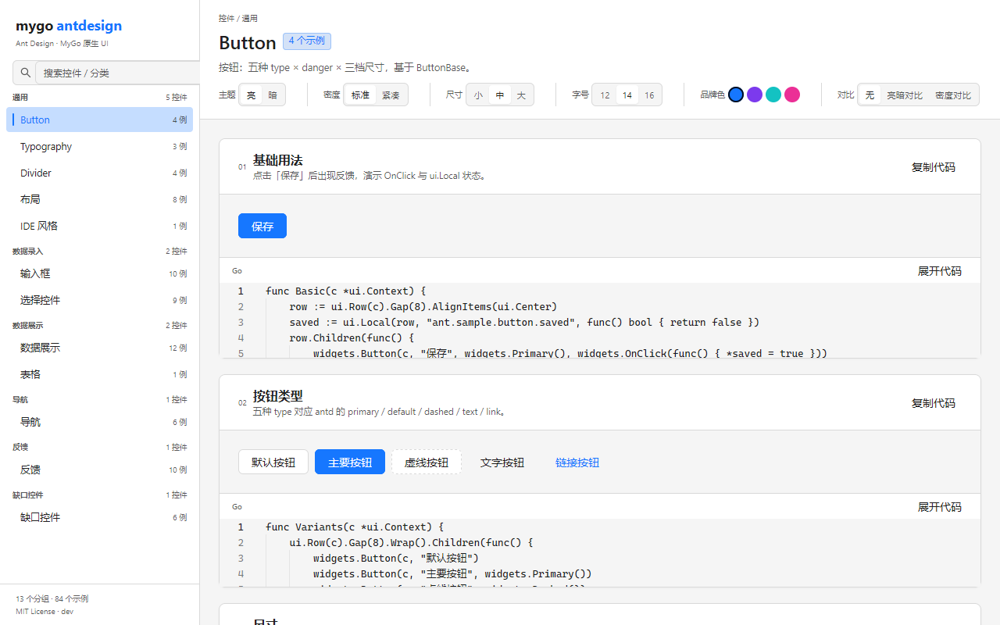
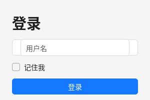

# mygo-antdesign


> Ant Design 设计风格的 [MyGo](https://github.com/egoist/mygo) 原生 UI 控件库

本仓库目标：为 MyGo 的 `package ui` 原生控件提供一套完整的 **Ant Design 视觉与交互规范**，并补齐 Ant Design 有而 MyGo 暂缺的控件。所有控件共享一套主题，支持**运行时切换**；在 Ant Design 标准间距之外，额外提供一套**紧凑密度**风格，用于上位机、IDE 等信息密集型场景。



*↑ 示例展示应用 Gallery：左侧控件目录、实时预览、旁边即真实示例代码，顶部可切换亮暗与标准/紧凑密度（`go run ./gallery` 运行）。*

## 快速开始

**安装**（Go 1.27.4+，MyGo v0.10.0）：

```bash
go get github.com/lishuangquan1987/mygo-antdesign@v0.1.0
```

**最小示例**（完整可编译）：

```go
package main

import (
	"fmt"
	"log"

	"github.com/egoist/mygo"
	"github.com/egoist/mygo/ui"

	"github.com/lishuangquan1987/mygo-antdesign/theme"
	widgets "github.com/lishuangquan1987/mygo-antdesign/widgets"
)

func main() {
	name := ""
	remember := false
	mygo.App.WhenReady(func() {
		mygo.NewWindow(mygo.WindowOptions{
			Title: "Hello mygo-antdesign",
			Content: ui.View(func(c *ui.Context) {
				// 一行接入主题：亮色预设 + 自定义品牌色。
				theme.Apply(c, theme.Light(theme.WithPrimary(ui.RGB(0x16, 0x77, 0xff))))

				// 间距一律走主题度量，切换密度时自动缩放。
				t := c.Theme()
				col := ui.Column(c).Gap(t.Space(3)).Padding(t.Space(6))
				col.Children(func() {
					widgets.Title(c, "登录", widgets.H2)
					widgets.Input(c, &name, widgets.PlaceholderText("用户名"))
					widgets.Checkbox(c, &remember, "记住我")
					widgets.Button(c, "登录", widgets.Primary(), widgets.OnClick(func() {
						fmt.Println("登录：", name, remember)
					}))
				})
			}),
		})
	})
	if err := mygo.App.Run(); err != nil {
		log.Fatal(err)
	}
}
```



**运行示例 Gallery**（浏览全部控件分组、切换主题/密度/品牌色、查看同屏亮暗对比）：

```bash
go run ./gallery
```

**下载安装包**：无需配置 Go 环境？到 [Releases](https://github.com/lishuangquan1987/mygo-antdesign/releases) 页下载对应平台的 Gallery 安装包（Windows / macOS / Linux，发布后由 CI 自动构建）。

**进阶**：主题自定义与运行时切换见 [docs/04](docs/04-theme-system.md)；紧凑密度见 [docs/05](docs/05-compact-density.md)；从 MyGo 原生控件迁移见 [docs/08](docs/08-migration.md)。

> **当前状态**
> - **v0.1.0**（已打 tag）：主题层 + 9 组换肤控件 + 首批缺口控件（Tree / Upload / Transfer / Carousel / QRCode）+ 44 个 antd 图标 + Gallery + 全部文档。
> - **v0.2**（已推送、待打 tag）：README 快速开始重写、Release 安装包流水线、Cascader / TreeSelect，截图基线按平台生效。
> - **v0.3**（开发中）：P1 缺口控件 Empty / Result / Skeleton / Statistic / Descriptions / Timeline / Spin。
> - 当前共 **77 个控件构造函数**（`widgets/` 70 + `extra/` 7）、**11 个示例分组 / 54 个示例片段**、**4 张 Gallery 截图基线**；尚未覆盖的控件与逐示例基线见 [docs/03](docs/03-gap-widgets.md) 与 [docs/06](docs/06-development-plan.md)。

## 一句话结论

**可行，且 MyGo 的底层设计天然契合**——它自带 headless Base、统一 Theme、`SetTheme` 运行时切换和 `Spacing` 密度单位，恰好对应 Ant Design 的「无样式组件 + Design Token + ConfigProvider + compactAlgorithm」四层能力。主要工作量在视觉规范翻译与缺口控件补齐，而非改造框架。详见 [可行性分析](docs/01-feasibility.md)。

## 设计原则

1. **不重复造轮子**：颜色、圆角、焦点环、禁用态、无障碍、键盘交互一律复用 MyGo 的 Theme 与 Base，只在「外观」层做 Ant Design 化。
2. **view = f(state)**：MyGo 是即时模式（immediate mode），控件是返回 Element 的 Go 函数，不是常驻对象。所有 API 按函数式设计，不引入命令式 `setText` 式调用。
3. **无 CSS 选择器**：MyGo 明确「State, not selectors」，因此 Ant Design 的 className / CSS-in-JS 动态样式要翻译成 Go 的条件分支与 Theme 字段。
4. **主题单一真源**：一套 Token 映射表驱动全部控件，杜绝每个控件各自硬编码颜色。
5. **密度是一等公民**：标准（Ant Design 默认）与紧凑两套密度共用同一组件实现，靠参数切换。
6. **示例是一等交付物**：每个示例都配可运行代码，展示不同主题、尺寸、密度与状态，代码与效果一一对应（见 [Samples & Gallery](docs/07-samples-gallery.md)）。

## 控件示例 Gallery

像 WPF 的 Material Design 示例程序一样，本库提供一个可运行的 **Gallery 应用**：左侧控件目录、中间实时预览、旁边可复制的真实代码，顶部可切换主题（亮/暗/品牌色）、密度（标准/紧凑），并支持**同屏并排对比**（借助 MyGo 的 `ui.Themed`）。示例同时用于视觉回归截图与文档插图。设计见 [07 Samples & Gallery](docs/07-samples-gallery.md)。

## 文档导航

| 文档 | 覆盖的需求 | 内容 |
| --- | --- | --- |
| [01 可行性分析](docs/01-feasibility.md) | 需求 2 | 技术契合度、架构分层、工作量、风险与里程碑 |
| [02 控件换肤映射](docs/02-widget-mapping.md) | 需求 3 | MyGo v0.10.0 全部原生控件 → Ant Design 皮肤的逐项映射与实现状态 |
| [03 缺口控件实现](docs/03-gap-widgets.md) | 需求 4 | Ant Design 有而 MyGo 无的控件：已交付、待实现、明确不移植 |
| [04 主题系统](docs/04-theme-system.md) | 需求 5 | Token 映射、运行时切换、全局/局部主题、预设 |
| [05 紧凑密度](docs/05-compact-density.md) | 需求 6 | 标准/紧凑两套密度规范、数值表、运行时切换 |
| [06 开发计划](docs/06-development-plan.md) | 整体 | WBS、里程碑、时间线、DoD、风险、当前进度 |
| [07 Samples & Gallery](docs/07-samples-gallery.md) | 示例展示 | 示例数据结构、覆盖矩阵、Gallery、截图回归、如何新增示例 |
| [08 迁移指南](docs/08-migration.md) | 采用 | 从 MyGo 原生到 antd 控件的对照迁移、事件差异、限制 |

## 目录约定

```
mygo-antdesign/
├── theme/        # Token 定义、预设主题、与 MyGo Theme 的桥接
├── widgets/      # 换肤后的控件（包名 ant，与 MyGo 原生一一对应）
├── extra/        # 缺口控件：Tree / Upload / Transfer / Carousel / QRCode / Cascader / TreeSelect
├── icon/         # Ant Design 图标的 SVG 常量（44 个 outlined）+ 渲染函数
├── samples/      # 示例源码（真实可编译，go:embed 提取代码片段）+ golden 基线
├── gallery/      # 示例展示应用：侧栏 + 实时预览 + 代码 + 主题/密度切换 + 并排对比
├── internal/     # 共享度量、状态映射、静态检查
├── scripts/      # genicons：图标常量生成器
└── docs/         # 文档集（含 decisions/ 与截图）
```

## License

[MIT](LICENSE) © 2026 lishuangquan1987
